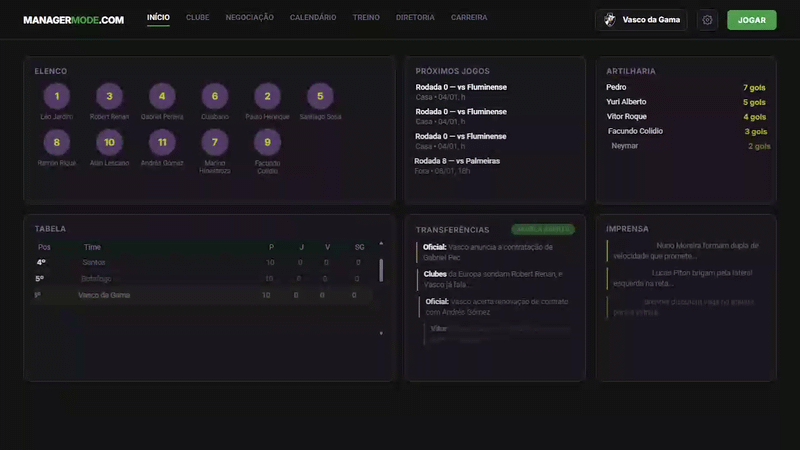
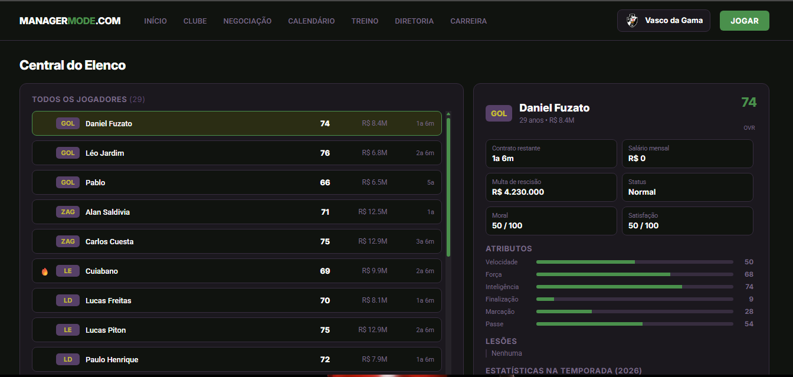
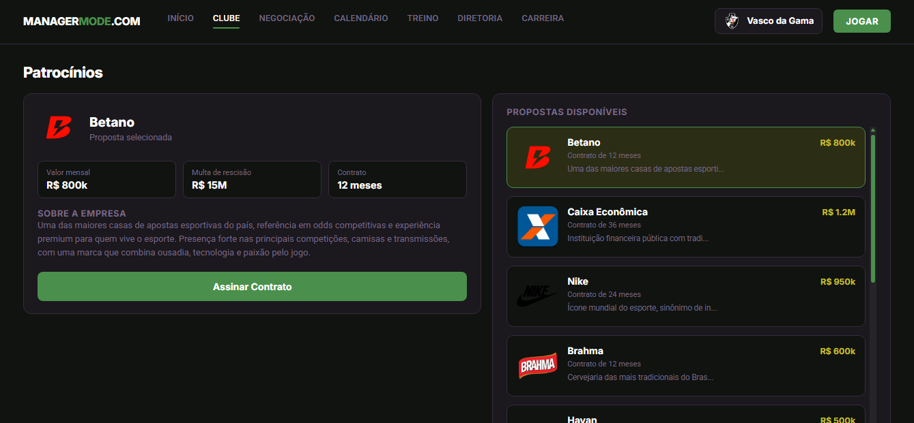
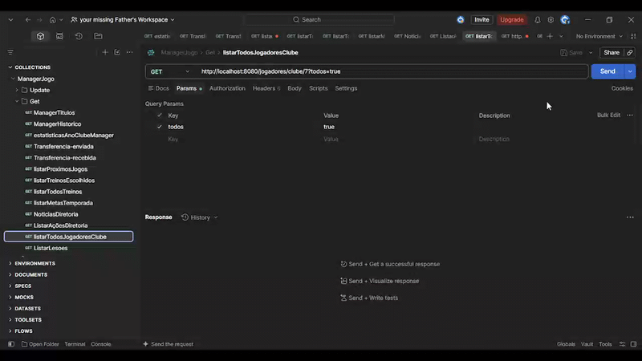

# ⚽ ManagerMode

> Você não joga a partida. Você decide **quem joga, quanto custa e quem vai te demitir**.

ManagerMode é um jogo de **manager de futebol pelo navegador**, ambientado no **Brasileirão Série A**, inspirado em sites como o 7a0 e o 38a0. Aqui o jogo acontece fora das quatro linhas: elenco, mercado, diretoria, patrocínios, imprensa e a reputação de quem está no banco.

<p align="center">
  
</p>

> 🎓 Projeto pessoal de estudo, sem fins lucrativos. Nasceu para eu aprender **Spring Boot** e **PHP** trabalhando juntos numa aplicação de verdade, com regra de negócio de verdade.

---

## 🎯 Por que esse projeto existe

Tutorial de CRUD ensina a sintaxe, mas não ensina o que acontece quando o projeto cresce. Escolhi um jogo de gestão porque ele obriga a lidar com o que um sistema real tem: muitas entidades se relacionando, regras que dependem umas das outras e estado que muda o tempo todo.

Cada decisão do jogo vira uma pergunta de engenharia:

| No jogo | No código |
|---|---|
| "Posso contratar esse jogador?" | Orçamento, multa de rescisão, contrato e proposta precisam bater |
| "A diretoria está insatisfeita" | Metas por temporada, ações e notícias ligadas ao clube |
| "Esse patrocinador exige reputação mínima" | Regra de negócio atravessando manager, clube e contrato |
| "Meu elenco está lesionado" | Relação N:N entre jogador e lesão, com gravidade e dias de recuperação |

---

## 🧭 O jogo em um minuto

1. Você cria seu técnico e escolhe um clube da Série A.
2. Cai na tela inicial com elenco, tabela, transferências e imprensa.
3. A partir daí, cada tela é uma frente de trabalho: **Clube**, **Negociação**, **Gestão** e **Carreira**.

<p align="center">
  
  
</p>

A base de jogadores cobre os **20 clubes** e **676 jogadores** da Série A 2025. Os atributos foram gerados por um modelo heurístico (nível do clube, idade e posição), com ajustes manuais nos grandes nomes.

O detalhamento de cada mecânica está em [`FUNCIONALIDADES.md`](FUNCIONALIDADES.md).

---

## 🧠 Decisões de projeto que valem a pena contar

**Um banco por jogador.** O `manager.sql` é um molde. Cada usuário recebe a sua própria instância do banco, e a API nunca altera o schema, só lê e grava dados. O `ddl-auto=validate` garante que, se o código e o banco divergirem, a aplicação nem sobe.

**API e front falam só por JSON.** O PHP não toca no banco. Tudo passa pelo `ApiService`, o que me forçou a pensar em contrato: o que cada endpoint devolve, o que é opcional, o que pode vir `null`.

**Estado da carreira como objeto.** A sessão começou como um array solto e migrou para uma classe `EstadoJogo`. Foi o primeiro refactor "de verdade" do projeto e rendeu um bom aprendizado sobre o que o `session_start()` espera encontrar (veja o troubleshooting da [instalação](INSTALACAO.md)).

**Camadas explícitas na API.** `controller → service → repository → model`, com `responses` separando o que vai pro front do que existe no banco.

```
┌──────────────┐   HTTP/JSON   ┌──────────────────┐   JPA    ┌─────────┐
│ manager-web  │ ────────────► │   manager-api    │ ───────► │  MySQL  │
│    (PHP)     │ ◄──────────── │  (Spring Boot)   │ ◄─────── │ manager │
└──────────────┘               └──────────────────┘          └─────────┘
```

---

## 🛠️ Stack

**Back-end:** Java 17 · Spring Boot · Spring Data JPA · Hibernate · Lombok · Maven
**Front-end:** PHP (cURL) · HTML · CSS · JavaScript
**Banco:** MySQL / MariaDB

---

## 🚧 Onde o projeto está hoje

Já funciona de ponta a ponta:

- Cadastro do técnico e escolha do clube
- Tela inicial, tabela, elenco e ficha detalhada do jogador (com lesões e estatísticas)
- Patrocínios, upgrades e histórico de temporadas do clube
- Mercado com busca, filtros, ordenação e paginação
- Carreira do técnico com propostas de emprego

Ainda é esqueleto ou está em construção:

- Ações dos botões (assinar patrocínio, aceitar proposta, melhorar clube, enviar proposta)
- Simulação de partidas e de temporada
- Leilões com bots, pressão de diretoria e lendas aposentadas

O histórico detalhado, dia a dia, está no [`CHANGELOG.md`](CHANGELOG.md).

<p align="center">
  
</p>

---

## 📚 Quer ir mais fundo?

| Quero... | Vá para |
|---|---|
| Rodar o projeto na minha máquina | [`INSTALACAO.md`](INSTALACAO.md) |
| Ver todos os endpoints | [`API.md`](API.md) |
| Entender cada mecânica do jogo | [`FUNCIONALIDADES.md`](FUNCIONALIDADES.md) |
| Saber o que mudou e quando | [`CHANGELOG.md`](CHANGELOG.md) |

Com a API no ar, o Swagger também mostra tudo em `http://localhost:8080/swagger-ui.html`.

---

## ⚖️ Aviso legal

Projeto **pessoal, educacional e sem fins lucrativos**, sem qualquer vínculo com clubes, ligas ou federações. Nomes e escudos são marcas registradas de seus respectivos proprietários e aparecem apenas para fins de estudo. Se algum titular quiser a remoção de algum material, é só abrir uma issue.
